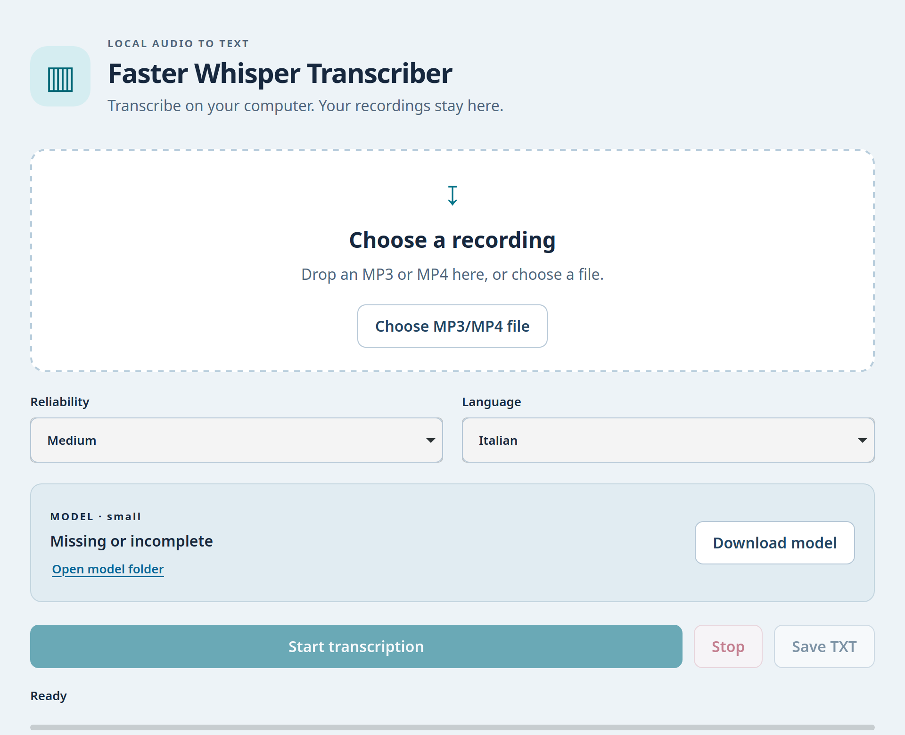

<p align="center">
  
</p>

# Faster Whisper Transcriber

Transcribe local MP3 and MP4 recordings on Linux and macOS with faster-whisper.
Choose a file, a reliability preset and a language, then save the transcription
as text. Audio and transcripts stay on your computer; models are downloaded only
when you ask.

Faster Whisper Transcriber is written for humans to read, maintain, and improve.

[](transcriber/docs/screenshots/desktop.png)

## Availability and requirements

**No Tauri desktop release has been published yet.** Run the current app from
source using the commands below. Native packages include the internal Python
engine; installed applications need no separate Python service or development
toolchain. Older PySide6 releases do not contain this desktop rewrite.

The desktop targets Ubuntu 24.04+ and macOS 14+, on x86_64 or ARM64, with a
graphical session. You need enough RAM and disk space for the selected model.
A GPU is optional. Model downloads require an internet connection; transcription
uses only local model files. Windows packages are not currently supported.

## Run from source

Install Node.js 22.13+, 24 or 26+, Rust 1.92+ with rustfmt/Clippy, Python 3.12 or
3.13 with venv support, and the platform's
[Tauri development prerequisites](https://v2.tauri.app/start/prerequisites/).
From the repository root, run:

```bash
npm --prefix transcriber/desktop ci
npm --prefix transcriber/desktop run desktop
```

`ci` installs JavaScript dependencies and automatically prepares the internal
Python environment with pinned, hash-verified dependencies. It downloads no models.
`desktop` opens the native application; Rust starts Python automatically whenever
needed. There is no additional service command. Use `desktop` again for later
sessions. If necessary, select an installed interpreter with `TRANSCRIBER_PYTHON`.

After development, close the app and reclaim disk space:

```bash
npm --prefix transcriber/desktop run clean
```

This removes only generated Rust files in `src-tauri/target`. Python dependencies,
models, application data, test evidence and packaging candidates are preserved.
The next native startup recompiles the removed files.

## First launch

1. Choose or drop an MP3/MP4 recording.
2. Choose **Reliability** and **Language**. Medium and Italian are the defaults.
3. If the selected model is missing, select **Download model** and wait for
   **Available locally**. **Open model folder** shows its cache directory.
4. Select **Start transcription**. **Stop** cancels the current operation.
5. Select **Save TXT** to save the result. Changing files or closing with an
   unsaved result asks before discarding it.

Presets retain the original mappings: High uses `large-v3`/accurate, Medium uses
`small`/balanced, and Low uses `base`/fast. Italian and English are available.
The original macOS model cache is reused when present.

See the [user and developer guide](transcriber/docs/guide.md) for the CLI,
storage, development, tests, packaging and troubleshooting. This project is
licensed under the [Apache License 2.0](LICENSE).
